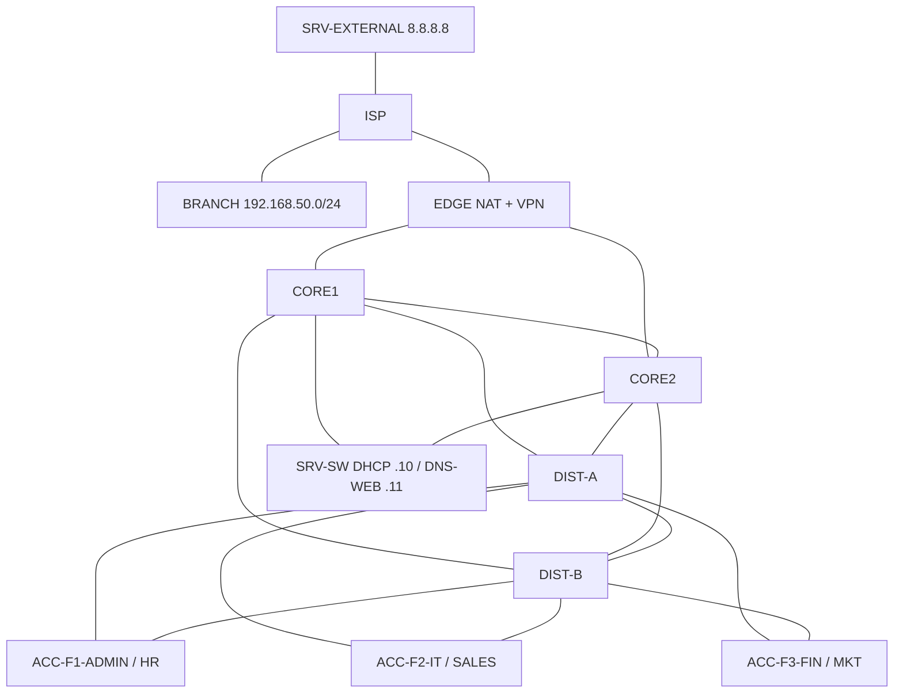

# Enterprise 3-Tier Network (Cisco Packet Tracer)

A fully redundant **Core / Distribution / Access** campus network with a branch site, built and documented in Cisco Packet Tracer.

   

## Features
- **3-tier design**: 2 Core, 2 Distribution (L3), 6 Access switches across 3 floors
- **VLANs & inter-VLAN routing** on the distribution layer (SVIs)
- **HSRP** gateways with load sharing (VLAN 10/30/50 active on DIST-A, 20/40/60 on DIST-B)
- **Rapid-PVST+** with matching root priorities and dual uplinks per access switch
- **OSPF (process 10, Area 0)** with passive interfaces and default-route origination
- **Extended ACLs** per department (inter-VLAN policy)
- **Centralized DHCP + DNS/Web** server with `ip helper-address`
- **NAT/PAT** on the edge router, **IPsec site-to-site VPN** to a branch
- **Port security** (sticky MAC), PortFast + BPDU Guard, unused ports shut down

## Topology

Add your exported diagram to `topology/` together with the `.pkt` file.

## VLANs
| VLAN | Name | Subnet | Floor |
|---|---|---|---|
| 10 | Administration | 10.1.10.0/24 | 1 |
| 20 | Human Resources | 10.1.20.0/24 | 1 |
| 30 | IT | 10.1.30.0/24 | 2 |
| 40 | Sales | 10.1.40.0/24 | 2 |
| 50 | Finance | 10.1.50.0/24 | 3 |
| 60 | Marketing | 10.1.60.0/24 | 3 |
| 150 | Servers | 10.1.150.0/24 | Server room |
| 191-193 | Management | 10.1.19x.0/24 | Floors 1-3 |

Full tables: [`docs/IP-Addressing.md`](docs/IP-Addressing.md) | ACL policy: [`docs/ACL-Policy.md`](docs/ACL-Policy.md) | Test plan: [`docs/Test-Results.md`](docs/Test-Results.md)

## How to use
1. Build the topology following the cable table in [`docs/Cabling.md`](docs/Cabling.md).
2. Open each device CLI and paste the matching file from [`configs/`](configs/).
3. On **EDGE** and **BRANCH**, enable the security license first (see comments at the top of the files), then reload.
4. On `SRV-DHCP`, create the pools listed in `docs/IP-Addressing.md`. On `SRV-DNS-WEB`, add `www.company.local -> 10.1.150.11`.
5. Run the tests in `docs/Test-Results.md` and save screenshots in `screenshots/`.

## Known limitations
- EDGE, ISP and the servers are single points of failure.
- Verify HSRP (`standby`) is supported by the 3560 image in your Packet Tracer version.
- The VPN pre-shared key (`VPNkey123`) is a **lab value only**. Never reuse it.
- The first VPN ping usually fails while IKE negotiates; retry.

## License
MIT
